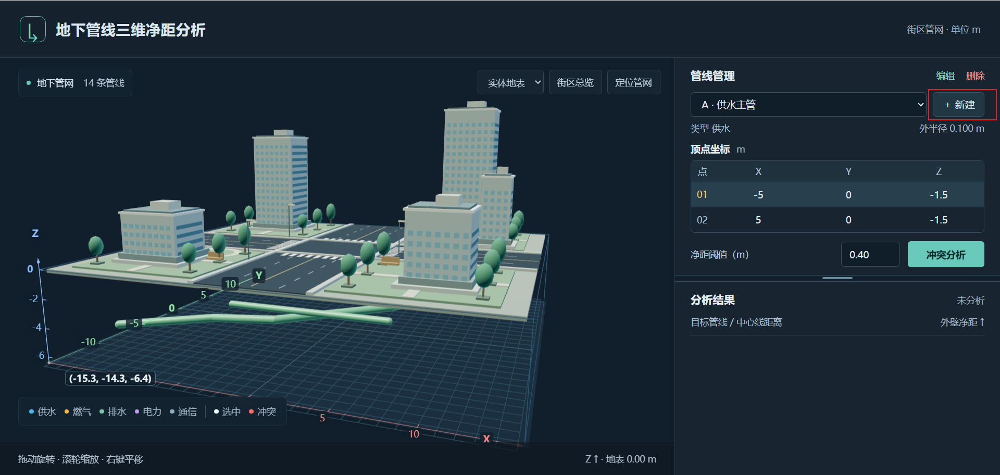
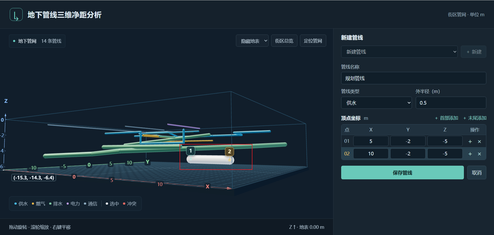
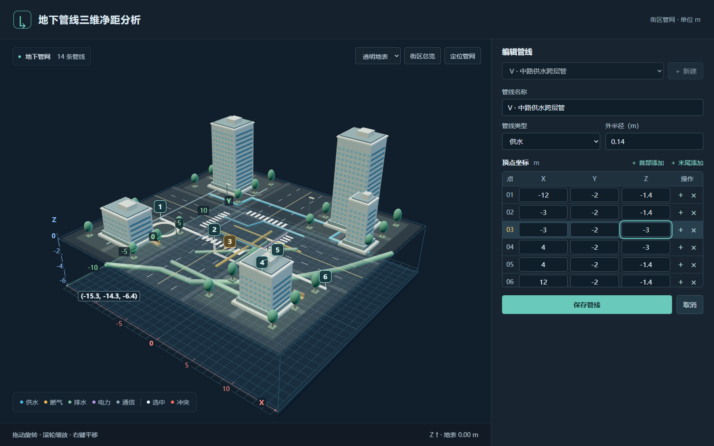
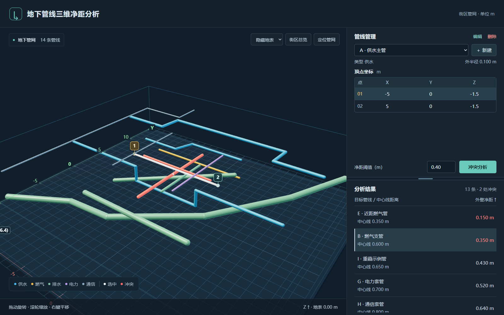
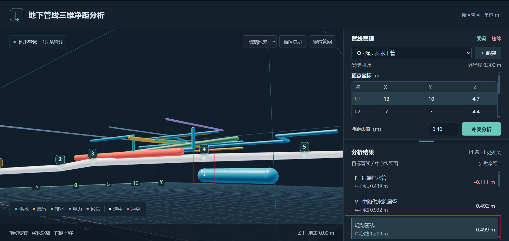
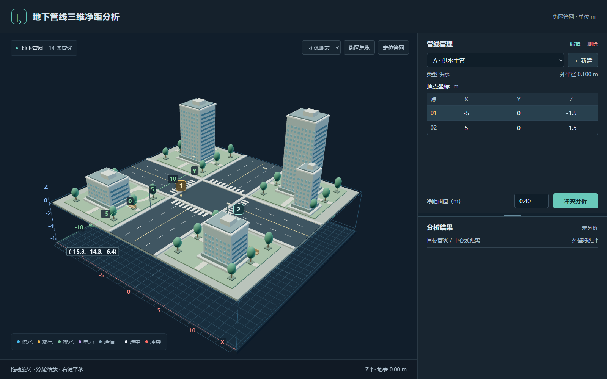

# 地下管线三维净距分析

基于 Spring Boot、MyBatis、PostGIS 和 Three.js 的地下管线管理与净距分析。内置 14 条管线，包含供水、燃气、排水、电力和通信五种类型。

## 运行

安装并启动 Docker Desktop（Linux 容器模式），在项目根目录执行：

```sh
docker compose up -d
```

首次启动会下载镜像和构建依赖，编译前后端，并自动创建数据库、导入管线。启动完成后访问 **http://localhost:8080**。本机只需 Docker，无需安装 Java、Node.js 或 PostgreSQL。

```sh
# 查看启动日志
docker compose logs -f app

# 停止服务
docker compose down

# 修改源代码后重新构建
docker compose up -d --build
```

管线数据保存在 Docker 的 `pipeline_data` 数据卷中。`db/init.sql` 负责建表、初始数据和自增编号，在首次创建数据库时自动执行。

## 五个功能

### 1. 新建管线

点击“＋ 新建”，输入名称、类型、外半径及顶点 XYZ 坐标。系统按表格顺序连接顶点，三维场景同步显示形状。



例如新建一条外半径为 `0.5 m` 的供水管并保存：



### 2. 编辑管线

点击场景中的管线，或通过右侧下拉框选中，再点击“编辑”。可修改名称、类型、外半径和每个顶点的坐标。

- “首部添加”：在第一个顶点前插入点。
- 每行“＋”：在该顶点后插入点。
- “末尾添加”：在最后一个顶点后增加点。
- 每行“×”：删除该顶点，管线至少保留两个顶点。

场景中的顶点编号与坐标表一一对应，点击坐标行可突出显示对应顶点。修改坐标时，管线形状实时更新。



### 3. 保存管线

新建或编辑完成后，点击“保存管线”写入 PostGIS。刷新页面或重启服务后，仍可查看和继续编辑。“取消”放弃本次修改。

保存完成后，可对这条管线进行冲突分析。

### 4. 冲突分析

选中已保存的管线，设置净距阈值，点击“冲突分析”。系统计算它与其他管线的三维净距，按外壁净距从小到大显示结果，低于阈值的管线标为红色。

点击一条分析结果，场景会突出显示目标管线，并绘制两条管线中心线之间的最短连线。修改阈值后点击“冲突分析”，可更新冲突标记。



点击目标管线还可以看到最短线段。



### 5. 删除管线

选中管线，点击右上角“删除”并确认。该管线从数据库和三维场景中移除。

## 三维界面

街区包含建筑、路面、绿地和树木，管线按类型区分颜色。坐标轴沿底板边缘显示，交点旁标注该角点的实际坐标，刻度与顶点表使用同一套坐标。



- **地表切换**：“实体地表”查看街区，“透明地表”同时观察地面与管网，“隐藏地表”集中查看地下管线。
- **视角操作**：拖动旋转、滚轮缩放、右键平移；“街区总览”恢复全景，“定位管网”拉近管线。
- **面板调整**：上下拖动右侧分隔线，调整坐标区与分析结果区的高度；双击恢复默认布局。

## 坐标与净距算法

XYZ 坐标和外半径均以米为单位。Z 轴向上，地表为 `Z=0`，`Z=-1.5` 表示地表下方 1.5 m。外半径指管道中心线到外壁的距离，外径等于外半径的两倍。

数据库以 `geometry(LineStringZ, 0)` 保存三维折线，SRID 为 0，使用本地米制坐标。保存时，将顶点按顺序组装为 `LINESTRING Z`，通过 `ST_GeomFromText` 写入；读取时，`ST_AsGeoJSON(geom, 15)` 将几何转换为 GeoJSON，坐标最多保留 15 位小数，后端取出其中的三维坐标数组交给前端。

```text
中心线距离 = ST_3DDistance(选中管线, 目标管线)
外壁净距 = 中心线距离 - 选中管线外半径 - 目标管线外半径
最短连线 = ST_3DShortestLine(选中管线, 目标管线)
冲突条件 = 外壁净距 < 净距阈值
```

分析遍历选中管线以外的所有已保存管线，一次 SQL 查询返回距离和连线端点。净距为负表示按两管外半径计算的外壁范围发生重叠。

例如初始管线 A 与 B 的中心线距离为 `0.60 m`，外半径分别为 `0.10 m` 和 `0.15 m`，外壁净距为 `0.35 m`。阈值设为 `0.40 m` 时，B 会被标记为冲突。

## 项目结构

```text
pipeline-clearance-demo/
├── backend/
│   ├── pom.xml                                      Maven 依赖与构建配置
│   └── src/main/
│       ├── java/com/example/pipeline/
│       │   ├── PipelineApplication.java             Spring Boot 启动入口
│       │   ├── controller/
│       │   │   └── PipelineController.java          管线增删改查与净距分析接口
│       │   ├── service/
│       │   │   ├── PipelineService.java             业务接口
│       │   │   └── impl/
│       │   │       └── PipelineServiceImpl.java     输入校验、管线保存与分析结果组装
│       │   ├── mapper/
│       │   │   └── PipelineMapper.java              MyBatis 数据访问接口
│       │   ├── entity/
│       │   │   ├── Pipeline.java                    数据库管线数据
│       │   │   └── ClearanceRow.java                净距查询结果
│       │   ├── dto/
│       │   │   └── PipelineRequest.java             新建、编辑管线的请求参数
│       │   ├── vo/
│       │   │   ├── PipelineVO.java                  返回前端的管线与顶点数据
│       │   │   └── ClearanceVO.java                 返回前端的净距与最短连线
│       │   └── common/
│       │       ├── Result.java                      统一响应格式
│       │       └── GlobalExceptionHandler.java      统一异常处理
│       └── resources/
│           ├── application.yml                      数据库与 MyBatis 配置
│           └── mapper/
│               └── PipelineMapper.xml              管线 CRUD 与 PostGIS 三维净距 SQL
├── frontend/             Three.js 场景、管线编辑与结果面板
├── db/
│   └── init.sql          建表、14 条初始管线、自增编号
├── docs/screenshots/     README 界面截图
├── scripts/              接口与增删改检查脚本
├── compose.yaml          数据库与应用容器
├── Dockerfile            前后端构建与运行镜像
└── README.md
```

## 接口

| 请求 | 用途 |
| --- | --- |
| `GET /api/pipelines` | 获取管线、外半径和三维顶点 |
| `POST /api/pipelines` | 保存新管线 |
| `PUT /api/pipelines/{id}` | 保存管线修改 |
| `DELETE /api/pipelines/{id}` | 删除管线 |
| `GET /api/pipelines/{id}/clearances` | 获取三维净距及最短连线 |

接口统一返回 `code`、`message` 和 `data`。新建和编辑的请求体相同：

```json
{
  "name": "规划供水管",
  "type": "供水",
  "radiusM": 0.1,
  "points": [[-5, -2, -1.5], [0, -2, -1.5], [5, 1, -2]]
}
```
